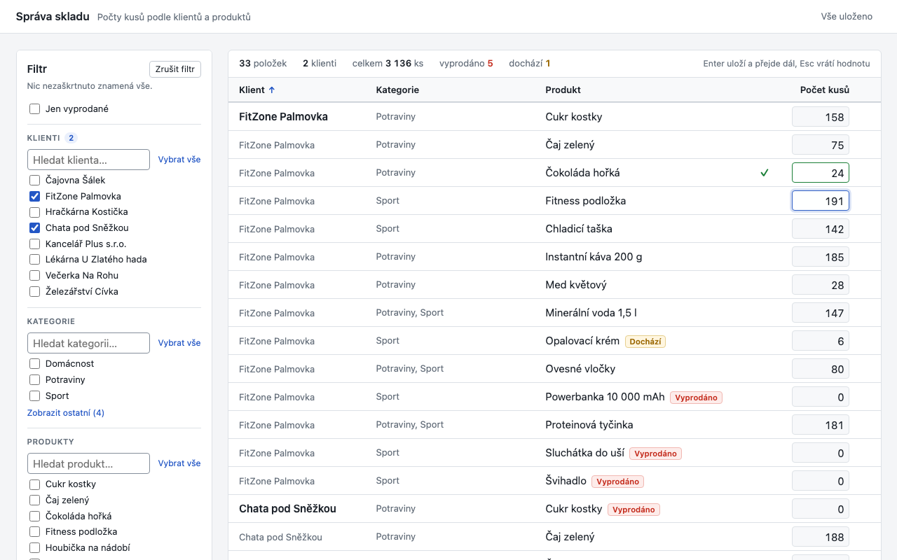

# Správa skladu

Webová aplikace v ASP.NET Core (.NET 10) pro správu skladu produktů: jedna stránka s filtrovatelným gridem, data přes REST API, uložení v SQLite přes Entity Framework Core.



## Spuštění

Potřeba je .NET 10 SDK.

```bash
dotnet run --project src/MedorSklad
```

Aplikace běží na http://localhost:5033, certifikát pro HTTPS není potřeba. Při prvním spuštění migrace vytvoří soubor `src/MedorSklad/medor-sklad.db` a naplní ho testovacími daty (8 klientů, 7 kategorií, 35 produktů, 120 skladových řádků). Pro čistý start stačí soubor smazat.

Testy:

```bash
dotnet test
```

Příklady volání API jsou v `src/MedorSklad/MedorSklad.http`, popis API v OpenAPI na http://localhost:5033/openapi/v1.json.

## Co aplikace umí

- Filtr podle klientů, kategorií a produktů s hledáním bez ohledu na diakritiku. Filtr je kaskádový: vybraní klienti zúží nabídku kategorií, kategorie zúží produkty. Už vybraná položka mimo rozsah se nezahodí, jen se označí "mimo výběr".
- Filtr a řazení jsou v adrese stránky, takže obnovení, tlačítko Zpět i sdílený odkaz ukážou totéž.
- Řazení podle libovolného sloupce (české řazení), souhrn řádků a kusů, zvýraznění vyprodaných a docházejících položek.
- Editace počtu kusů přímo v gridu jako v tabulce: Enter uloží a skočí na další řádek, šipky přecházejí mezi řádky, Esc vrátí poslední potvrzenou hodnotu, tlačítka − a + mění o 1.
- Ochrana proti přepsání cizí změny: když řádek mezitím změnil někdo jiný, uložení se odmítne a u buňky se nabídne převzít aktuální hodnotu, nebo vědomě přepsat. Zadání jiné hodnoty se bere jako vědomé přepsání. Vyzkoušet jde ve dvou záložkách prohlížeče.
- Přepínač "Jen vyprodané" pro rychlý přehled vyprodaného.

## Doménový model

- **Produkt** je společný pro všechny klienty a může patřit do více kategorií.
- **Klient** má přidělené kategorie, kterými se zabývá. Jeho sortiment tvoří všechny produkty z těchto kategorií.
- **Skladová položka** (`StockItem`) drží počet kusů konkrétního produktu na skladu konkrétního klienta a verzi řádku pro hlídání souběžných úprav. Každý klient má tedy vlastní sklad.
- Pro každou dvojici klient × produkt ze sortimentu existuje právě jedna skladová položka (seed je zakládá všechny předem).

```
Klient *---* Kategorie *---* Produkt
Klient 1---* StockItem *---1 Produkt
```

Jeden řádek gridu je jeden produkt na skladu jednoho klienta. Sloupec Kategorie ukazuje jen ty kategorie produktu, kterými se klient zabývá. Filtr kategorií ponechá řádek, pokud produkt u daného klienta spadá aspoň do jedné vybrané kategorie. Prázdná skupina filtru znamená bez omezení, skupiny se kombinují logickým AND.

## Rozhodnutí a kompromisy

| Rozhodnutí | Proč | Ve větším systému |
|---|---|---|
| Řádek gridu = klient × produkt | Produkt ve dvou kategoriích klienta by jinak byl v gridu dvakrát se stejným počtem kusů | Stejně |
| Skladové řádky založené předem pro celý sortiment | Úprava je pak jen UPDATE, odpadá souběh dvou vložení stejného řádku. Když klient přijde o kategorii, řádky v DB zůstanou, jen se nezobrazí | Založení řádků při přidělení kategorie |
| Verze řádku jako číslo spravované aplikací | SQLite nemá rowversion | `rowversion` (`[Timestamp]`) na MS SQL |
| 409 s aktuální hodnotou místo "poslední zápis vyhrává" | Dva lidé upravující stejnou buňku by si jinak tiše přepsali data | Stejně |
| 422 pro produkt mimo sortiment, 400 pro neplatné tělo | 400 znamená špatně poslaný požadavek, 422 platný požadavek porušující doménové pravidlo | Stejně |
| Controllery místo Minimal API | Fungovaly už ve v1 a odpovídají MVC světu | Podle zvyklostí týmu |
| Migrace + `UseSeeding` místo `EnsureCreated` | Schéma se dá dál vyvíjet, seed běží jen nad prázdnou DB | Migrace nasazované zvlášť, bez seedu |
| České řazení v paměti | Řádků je kolem 120, SQLite českou collation nemá | Collation `Czech_CI_AS` na MS SQL a řazení v DB |
| Bez stránkování | Řádků je kolem 120 | Stránkování a řazení na serveru |
| Čistý JavaScript bez knihoven a bez build kroku | 4 sloupce a 3 filtry knihovnu nepotřebují, aplikace jde spustit jediným příkazem bez Node.js | Podle velikosti frontendu |
| Ne Blazor | Serverová varianta posílá data přes SignalR místo REST, WebAssembly přidá druhý projekt a velké první načtení | Stejně |
| Bez Clean Architecture, repository a MediatR | DbContext už je unit of work, další vrstvy by jen přidaly soubory | Podle velikosti domény |

## REST API

| Metoda | Cesta | Popis |
|---|---|---|
| GET | `/api/filters` | Klienti a produkty i s id svých kategorií, kategorie; vše česky seřazené |
| GET | `/api/stock?clientIds=1&clientIds=2&categoryIds=3&productIds=7&onlyOutOfStock=true` | Řádky gridu. Parametry lze opakovat, chybějící parametr znamená bez omezení |
| PUT | `/api/stock/{clientId}/{productId}` | Tělo `{ "quantity": 12, "version": 3 }`, nastaví počet kusů |

PUT vrací:

- `200` a upravený řádek s verzí zvýšenou o 1,
- `400` pro chybějící, záporný, desetinný nebo příliš velký počet a pro chybějící verzi (české hlášky v `errors.Quantity`, `errors.Version`),
- `404` pro neexistujícího klienta či produkt,
- `422` pro produkt mimo sortiment klienta,
- `409` pokud se verze řádku mezitím změnila.

Chyby mají tvar ProblemDetails (`application/problem+json`) s českým titulkem a hláškou. Odpověď 409 nese i aktuální stav řádku:

```json
{
  "type": "https://tools.ietf.org/html/rfc9110#section-15.5.10",
  "title": "Konflikt souběžné úpravy",
  "status": 409,
  "detail": "Počet kusů mezitím změnil někdo jiný.",
  "traceId": "00-...",
  "currentQuantity": 21,
  "currentVersion": 1
}
```

## Struktura

```
src/MedorSklad/
  Controllers/      REST API (filtry, sklad) a české odpovědi 400
  Services/         StockService: dotazy gridu a úprava počtu kusů s kontrolou verze
  Contracts/        DTO pro API
  Data/             entity, DbContext, seed testovacích dat
  Data/Migrations/  EF migrace
  wwwroot/
    index.html
    css/app.css
    js/             ES moduly bez build kroku: api, url-state, filters, filter-group,
                    grid, editing, row-saver, format, dom, main
tests/MedorSklad.Tests/
  StockServiceTests  pravidla gridu, filtru a úprav nad SQLite v paměti
  ApiTests           REST API přes celou aplikaci (WebApplicationFactory)
  DataTests          migrace a seed
  SiteTests          stránka a moduly se servírují, nic se nenačítá z cizích serverů
  SecurityTests      bezpečnostní hlavičky (CSP, nosniff), 413 pro příliš velké tělo bez interních detailů
```

## Vědomě vynecháno

- Přihlašování a role. API je bez autentizace a `clientId` v URL se neověřuje, kdokoli s přístupem na port tedy může měnit stav libovolného klienta. Proto aplikace poslouchá jen na localhost a `AllowedHosts` povoluje jen localhost (brání DNS rebindingu). Před nasazením by přibylo přihlášení, kontrola oprávnění ke klientovi v `PUT /api/stock/{clientId}/...` a HTTPS.
- Správa klientů, kategorií a produktů (data jsou ze seedu).
- Historie změn (audit).
- Stránkování.
- Docker a build krok pro frontend.
- Změna filtru načte grid znovu až po dokončení rozpracovaných uložení. Nevyřešený konflikt nebo neplatná hodnota v buňce se tím zahodí; při zavření stránky s nimi ale prohlížeč varuje.

## Co bych udělal dál

- MS SQL s `rowversion`.
- Pohyby zásob (příjem, výdej) jako neměnný záznam, ze kterého se počet kusů počítá.
- Stránkování a řazení na serveru s českou collation.
- Role podle klienta.
- End-to-end testy v Playwright.

## Kolik času mi to zabralo

Celkem zhruba 2 až 3 hodiny mé práce. Kód z velké části psali agenti v Claude Code, můj čas šel hlavně do zadání, rozhodování a kontroly.

- **v1** (základ, který splňuje zadání): vygenerovaná asi za 15 minut, pak jsem ji prošel a spustil.
- **v2** (lepší filtr, editace z klávesnice, ochrana proti souběžné úpravě, README): návrh agenti připravili zhruba za 8 minut, implementaci a review zhruba za 31 minut.
- **Vyladění UI a bezpečnostní review**: dvě další kola nad hotovou verzí.
- Zbytek času jsem strávil procházením kódu, zkoušením v prohlížeči a rozhodováním, co z návrhů vzít.

## Jak jsem pracoval s AI

**Nástroje:** Claude Code (Claude Opus) a v něm workflow s více agenty běžícími paralelně.

**Co jsem delegoval:** psaní backendu, frontendu a testů, rešerši open-source vzorů pro .NET a EF Core a review kódu. Review dělalo několik agentů s různými úhly pohledu (správnost, frontend, shoda se zadáním, pohled hodnotitele) a ke každému nálezu skeptik, který se ho snažil vyvrátit. Opravovalo se jen to, co obstálo.

**Co jsem rozhodl sám:** zadání pro agenty, rozsah (žádné přihlašování, žádný Docker), co z návrhů vzít, kdy je UI hotové a že se před odevzdáním udělá ještě bezpečnostní review.

**Co jsem z návrhů odmítl:** nechal jsem zpracovat čtyři nezávislé varianty řešení. Blazor jsem nevzal, protože serverová varianta posílá data přes SignalR místo REST, které zadání chce. Gridovou knihovnu jsem nevzal, protože 4 sloupce a 3 filtry ji nepotřebují a přidala by závislost. Zvolil jsem nejjednodušší variantu: controllery, EF Core a čistý JavaScript bez build kroku.

**Jak jsem výsledky ověřoval:** 48 testů (služba, REST API, migrace a seed, statické soubory, bezpečnostní hlavičky), build bez varování, sestavení z čistého klonu a proklikání scénářů v prohlížeči včetně konfliktu ze dvou záložek. Bezpečnost agenti testovali skutečnými útoky na běžící instanci (SQL injection, XSS v názvech, obří vstupy, cizí hlavička Host).

**Chyby, které AI udělala** (zachytily je testy nebo review):

- PUT bez `quantity` ve v1 tiše vynuloval sklad, protože chybějící číslo se načetlo jako 0. Teď vrací 400.
- Validační atribut na špatném místě způsobil, že každý PUT vracel 500.
- Dotaz gridu byl napsaný jako jeden vnořený dotaz, který EF Core na SQLite neumí přeložit. Je rozdělený na dva.
